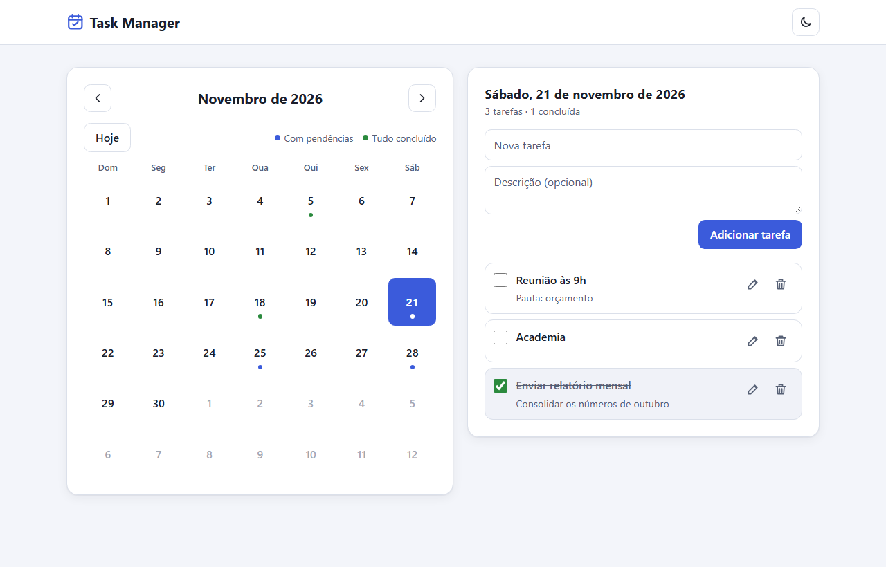
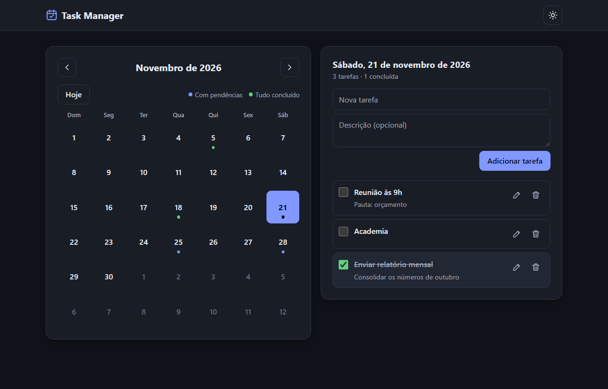
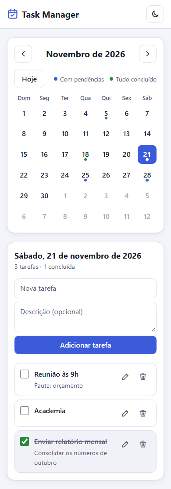

# Task Manager

Veja como usar o task-manager: [como_usar_o_task-manager.mp4](docs/videos/como_usar_o_task-manager.mp4) (clique no link e em seguida em "View raw")

Aplicativo web para controle pessoal de tarefas, organizado por um calendário mensal. Cada tarefa pertence a um dia; ao clicar em um dia, você vê, cadastra, edita, conclui e exclui as tarefas daquela data.

A aplicação é um único arquivo executável Java. O banco de dados (SQLite) é criado automaticamente na primeira execução e não exige a instalação de nenhum servidor de banco de dados.



## Funcionalidades

- Calendário mensal com navegação entre meses e botão para voltar ao dia atual.
- Destaque do dia atual e do dia selecionado.
- Marcação dos dias com tarefas: ponto azul quando há pendências e ponto verde quando todas as tarefas do dia estão concluídas.
- Cadastro de tarefas com título obrigatório e descrição opcional.
- Edição de título e descrição.
- Exclusão com confirmação.
- Marcação de concluída ou pendente por checkbox, gravada no banco de dados.
- Diferenciação visual das tarefas concluídas (texto riscado e fundo diferente, listadas depois das pendentes).
- Modo claro e modo escuro, com a escolha salva no navegador.
- Interface responsiva para computador, tablet e celular.
- Mensagens de confirmação e de erro, sem recarregar a página.
- Navegação pelo calendário com o teclado (setas).

| Modo escuro | Celular |
|---|---|
|  |  |

## Tecnologias

| Camada | Tecnologia |
|---|---|
| Linguagem | Java 21 |
| Framework | Spring Boot 3.5 (Web, Data JPA, Validation) |
| Persistência | Hibernate 6.6 com dialeto SQLite (`hibernate-community-dialects`) |
| Banco de dados | SQLite (driver `org.xerial:sqlite-jdbc`) |
| Versionamento do esquema | Flyway |
| Interface | HTML, CSS e JavaScript puro (módulos ES), sem etapa de build |
| Testes | JUnit 5, Mockito, Spring Boot Test, MockMvc, AssertJ |
| Build | Maven (com Maven Wrapper) |

A justificativa de cada escolha está em [docs/ARQUITETURA.md](docs/ARQUITETURA.md).

## Requisitos para execução

- Java 21 (JDK para compilar; JRE basta para apenas executar o JAR).
- Acesso à internet na primeira compilação, para o Maven baixar as dependências.

Não é preciso instalar Maven: o projeto inclui o Maven Wrapper (`mvnw` e `mvnw.cmd`).

## Instalação e execução

```bash
git clone https://github.com/ubaldomattos/task-manager.git
cd task-manager

# Linux / macOS
./mvnw spring-boot:run

# Windows
mvnw.cmd spring-boot:run
```

Abra <http://localhost:8080> no navegador.

Para gerar e executar o JAR:

```bash
./mvnw package          # Windows: mvnw.cmd package
java -jar target/task-manager.jar
```

### Configuração

| Variável de ambiente | Padrão | Descrição |
|---|---|---|
| `TASKMANAGER_DB_PATH` | `./data/taskmanager.db` | Caminho do arquivo SQLite. Diretórios ausentes são criados. |
| `TASKMANAGER_PORT` | `8080` | Porta HTTP. |
| `TASKMANAGER_ADDRESS` | `127.0.0.1` | Endereço de escuta. O padrão aceita apenas acessos da própria máquina. |

O passo a passo completo, incluindo instalação do Java e solução de problemas, está em [docs/INSTALACAO.md](docs/INSTALACAO.md).

## Estrutura do projeto

```
task-manager/
├── pom.xml                      Build Maven
├── mvnw, mvnw.cmd, .mvn/        Maven Wrapper
├── docs/                        Documentação técnica e imagens
└── src/
    ├── main/
    │   ├── java/br/com/taskmanager/
    │   │   ├── TaskManagerApplication.java
    │   │   ├── config/          DataSource SQLite e propriedades
    │   │   ├── shared/          Conversores de persistência e tratamento global de erros
    │   │   └── task/            Funcionalidade de tarefas
    │   │       ├── controller/  API REST
    │   │       ├── service/     Casos de uso
    │   │       ├── repository/  Acesso a dados (Spring Data JPA)
    │   │       ├── domain/      Entidade Task e suas regras
    │   │       ├── dto/         Objetos de entrada e saída da API
    │   │       └── exception/   Exceções de negócio
    │   └── resources/
    │       ├── application.yml
    │       ├── db/migration/    Migrações Flyway
    │       └── static/          Interface web (HTML, CSS, JS)
    └── test/java/...            Testes automatizados
```

## API

| Método | Rota | Descrição |
|---|---|---|
| `GET` | `/api/tasks?date=2026-11-21` | Tarefas do dia |
| `GET` | `/api/tasks/summary?month=2026-11` | Total e pendentes por dia do mês |
| `POST` | `/api/tasks` | Cria tarefa |
| `PUT` | `/api/tasks/{id}` | Edita título e descrição |
| `PATCH` | `/api/tasks/{id}/completion` | Marca como concluída ou pendente |
| `DELETE` | `/api/tasks/{id}` | Exclui tarefa |

Os erros seguem o formato Problem Details (RFC 9457), com mensagens em português.

## Testes

```bash
./mvnw test             # Windows: mvnw.cmd test
```

A suíte tem 52 testes:

- **Domínio** (`TaskTest`): regras da entidade, como normalização do título, limites de tamanho e conclusão.
- **Serviço** (`TaskServiceImplTest`): casos de uso com o repositório simulado por Mockito.
- **Persistência** (`TaskRepositoryTest`): consultas e gravação em um arquivo SQLite real, com o esquema criado pelo Flyway.
- **Endpoints** (`TaskControllerTest`): status HTTP, validação e formato dos erros com MockMvc.
- **Fluxo completo** (`TaskFlowIntegrationTest`): cadastro, edição, conclusão e exclusão pela API, com a aplicação inteira.
- **Banco de dados** (`DatabasePersistenceTest`): criação automática do banco e preservação dos dados após reiniciar a aplicação.

Cada teste de integração usa um arquivo SQLite próprio em `target/test-databases/`.

## Documentação

- [Requisitos](docs/REQUISITOS.md)
- [Arquitetura](docs/ARQUITETURA.md)
- [Manual de instalação](docs/INSTALACAO.md)
- [Manual do usuário](docs/MANUAL_USUARIO.md)

## Licença

Distribuído sob a licença MIT. Veja [LICENSE](LICENSE).
