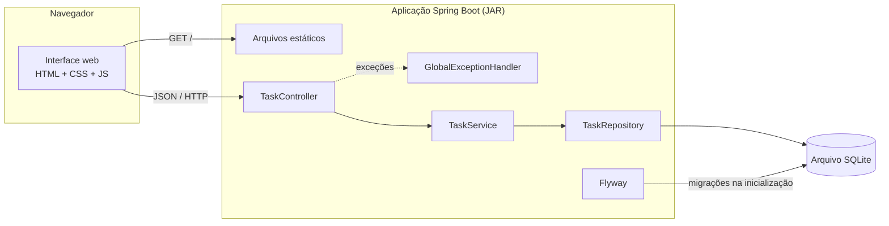
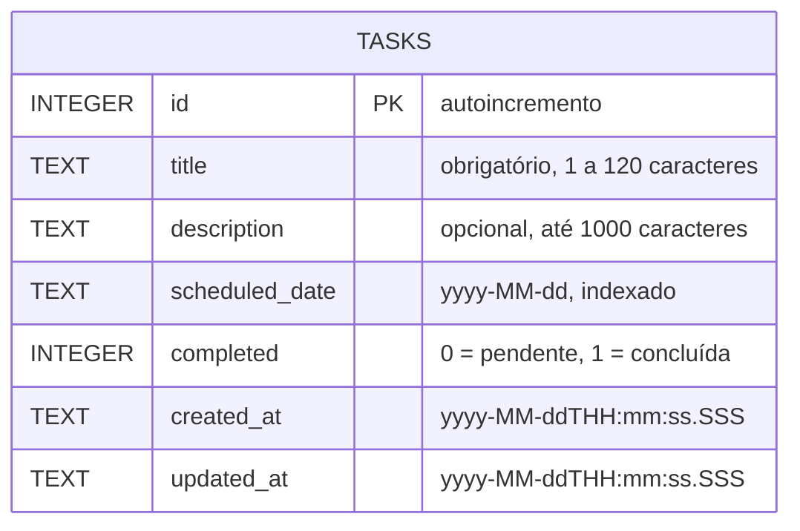
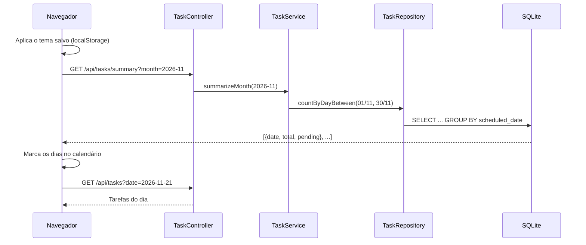

# Documento de Arquitetura

## 1. Visão geral

O Task Manager é uma aplicação monolítica em camadas, empacotada em um único JAR. O mesmo processo Spring Boot serve a interface web (arquivos estáticos) e uma API REST em JSON. A interface consome a API com `fetch`, sem recarregar a página. Os dados ficam em um arquivo SQLite local.



## 2. Tecnologias e justificativas

| Tecnologia | Uso | Justificativa |
|---|---|---|
| Java 21 | Linguagem | Versão LTS exigida pelo projeto; oferece `record` para DTOs e text blocks para consultas. |
| Spring Boot 3.5 | Framework | Servidor embutido (Tomcat), configuração externalizada, validação e testes integrados. Gera um JAR executável. |
| Spring Data JPA + Hibernate 6.6 | Persistência | Repositórios declarativos e mapeamento objeto-relacional. Permite trocar de banco no futuro com poucas mudanças. |
| SQLite (`sqlite-jdbc`) | Banco de dados | Banco em arquivo, sem servidor. Atende ao requisito de não instalar SGBD. |
| `hibernate-community-dialects` | Dialeto SQLite | O Hibernate 6 mantém o dialeto do SQLite nesse módulo oficial. |
| Flyway | Esquema do banco | Cria o banco na primeira execução e aplica migrações versionadas nas evoluções. |
| HTML, CSS e JavaScript puro | Interface | Ver seção 2.1. |
| JUnit 5, Mockito, MockMvc, AssertJ | Testes | Ferramentas padrão do ecossistema Spring, já incluídas no `spring-boot-starter-test`. |

### 2.1 Por que JavaScript puro na interface

A interface tem duas áreas (calendário e lista do dia) e seis operações. Para esse tamanho:

- **Sem etapa de build:** não exige Node.js nem npm. Quem clona o projeto só precisa de Java.
- **Um único artefato:** os arquivos estáticos vão dentro do JAR.
- **Separação clara:** a interface conversa com o backend apenas pela API REST. O backend é testável sem navegador, e a interface pode ser trocada sem mexer nele.
- **Recursos nativos suficientes:** módulos ES, `fetch`, `<dialog>`, `Intl.DateTimeFormat` e variáveis CSS cobrem tudo o que foi pedido.

Alternativas avaliadas:

- **Thymeleaf com HTMX:** também dispensa build, mas mistura renderização de interface com o servidor e deixa a API menos reutilizável.
- **React, Vue ou Angular:** trariam toolchain Node e dezenas de dependências sem ganho real neste escopo.

## 3. Organização dos módulos e pacotes

O código é organizado por funcionalidade (`task`) e, dentro dela, por camada. Novas funcionalidades ganham pacotes irmãos, sem inflar os existentes.

```
br.com.taskmanager
├── TaskManagerApplication        Inicialização
├── config
│   ├── DatabaseConfig            Cria o DataSource SQLite e o diretório do banco
│   └── DatabaseProperties        Propriedade taskmanager.database.path
├── shared
│   ├── persistence
│   │   ├── LocalDateTextConverter       LocalDate ⇄ texto ISO
│   │   └── LocalDateTimeTextConverter   LocalDateTime ⇄ texto ISO
│   └── web
│       └── GlobalExceptionHandler       Exceções → Problem Details
└── task
    ├── controller   TaskController
    ├── service      TaskService (interface), TaskServiceImpl
    ├── repository   TaskRepository, DailyTaskCount
    ├── domain       Task
    ├── dto          CreateTaskRequest, UpdateTaskRequest, CompletionRequest,
    │                TaskResponse, DaySummaryResponse
    └── exception    TaskNotFoundException, InvalidTaskException
```

Interface web (`src/main/resources/static`):

```
static/
├── index.html          Estrutura da página e script que aplica o tema antes da renderização
├── favicon.svg
├── css/styles.css      Temas (variáveis CSS), layout responsivo e componentes
└── js/
    ├── app.js          Ponto de entrada: liga calendário, painel, tema e API
    ├── api.js          Cliente da API REST e tratamento de erros HTTP
    ├── calendar.js     Calendário mensal, navegação e marcadores
    ├── task-panel.js   Lista, cadastro, edição, exclusão e conclusão
    ├── feedback.js     Mensagens temporárias e diálogo de confirmação
    ├── theme.js        Alternância e persistência do tema
    └── dates.js        Formatação e cálculo de datas
```

## 4. Responsabilidades das principais classes

| Classe | Responsabilidade |
|---|---|
| `Task` | Entidade JPA. Garante as regras de negócio: título obrigatório e normalizado, limites de tamanho, descrição vazia tratada como ausente, data fixa, criação como pendente e preenchimento das datas de auditoria (`@PrePersist`/`@PreUpdate`). |
| `TaskRepository` | Consulta as tarefas de um dia na ordem da regra RN07 e conta tarefas totais e pendentes por dia em um intervalo. |
| `TaskService` / `TaskServiceImpl` | Casos de uso e limites de transação. Converte entidades em DTOs e registra as operações em log. O controller depende só da interface. |
| `TaskController` | Recebe as requisições HTTP, valida os DTOs com Bean Validation e delega ao serviço. Não contém regra de negócio. |
| `GlobalExceptionHandler` | Converte exceções em respostas Problem Details (RFC 9457) com mensagens em português. Erros de validação trazem o mapa `errors` por campo. Erros inesperados são registrados em log e devolvidos sem detalhes internos. |
| `DatabaseConfig` | Cria o `HikariDataSource` com a URL `jdbc:sqlite:<caminho>` e cria o diretório do banco, que o driver SQLite não cria sozinho. |
| `LocalDate…Converter` | Gravam datas como texto ISO-8601 legível e ordenável. |

## 5. Modelo de dados



Script da migração `V1__criar_tabela_tasks.sql`:

```sql
CREATE TABLE tasks (
    id             INTEGER PRIMARY KEY AUTOINCREMENT,
    title          TEXT    NOT NULL CHECK (length(title) BETWEEN 1 AND 120),
    description    TEXT             CHECK (description IS NULL OR length(description) <= 1000),
    scheduled_date TEXT    NOT NULL,
    completed      INTEGER NOT NULL DEFAULT 0 CHECK (completed IN (0, 1)),
    created_at     TEXT    NOT NULL,
    updated_at     TEXT    NOT NULL
);

CREATE INDEX idx_tasks_scheduled_date ON tasks (scheduled_date);
```

As restrições `CHECK` repetem no banco as regras da entidade, como proteção contra gravações feitas por fora da aplicação.

O Flyway também cria a tabela `flyway_schema_history`, onde registra as migrações já aplicadas.

## 6. Fluxo de comunicação

### 6.1 Abertura da aplicação



### 6.2 Marcação de conclusão

```mermaid
sequenceDiagram
    participant U as Navegador
    participant C as TaskController
    participant S as TaskService
    participant T as Task
    participant D as SQLite

    U->>C: PATCH /api/tasks/7/completion {"completed": true}
    C->>C: Valida CompletionRequest
    C->>S: changeCompletion(7, true)
    S->>D: SELECT tarefa 7
    S->>T: changeCompletion(true)
    S->>D: UPDATE (flush; @PreUpdate renova updated_at)
    S-->>U: 200 TaskResponse
    U->>U: Reordena a lista e mostra "Tarefa concluída."
    U->>C: GET /api/tasks/summary?month=2026-11
    U->>U: Atualiza o marcador do dia
```

### 6.3 Tratamento de erros

| Situação | Status | Exemplo de `detail` |
|---|---|---|
| Campo inválido no corpo | 400 | "O título é obrigatório." |
| Regra de negócio violada | 400 | "O título deve ter no máximo 120 caracteres." |
| JSON mal formado | 400 | "O corpo da requisição está mal formado ou contém valores inválidos." |
| Parâmetro ausente ou inválido | 400 | "O valor do parâmetro 'month' é inválido." |
| Tarefa inexistente | 404 | "Tarefa 99 não encontrada." |
| Erro inesperado | 500 | "Ocorreu um erro inesperado. Tente novamente em instantes." |

A interface exibe o campo `detail` diretamente ao usuário. Quando o servidor não responde, ela exibe uma mensagem própria de falha de conexão.

## 7. Decisões arquiteturais

| Decisão | Motivo | Consequência |
|---|---|---|
| Esquema gerenciado pelo Flyway, com `ddl-auto: none` | Evoluções do modelo ficam versionadas e reproduzíveis, sem alterações automáticas imprevisíveis. | Toda mudança no modelo exige uma nova migração `V<n>__descricao.sql`. |
| Pool com uma única conexão | O SQLite aceita uma escrita por vez; uma conexão elimina erros "database is locked". | Requisições ao banco são serializadas, o que é suficiente para uso pessoal. |
| Datas gravadas como texto ISO | O SQLite não tem tipo de data nativo. Texto ISO é legível, independe de fuso e ordena corretamente para consultas por intervalo. | Conversores JPA explícitos nas colunas de data. |
| Regras de negócio na entidade `Task` | A entidade não pode entrar em estado inválido, independentemente de quem a usa. A validação dos DTOs dá mensagens por campo; a da entidade protege as regras. | A validação de tamanho existe nas duas camadas e no banco. |
| Serviço exposto por interface | O controller depende de uma abstração (inversão de dependência), o que facilita testes e substituições. | Uma interface e uma implementação. |
| DTOs como `record` | Objetos imutáveis e concisos; a entidade não sai da camada de serviço. | Conversão explícita em `TaskResponse.from`. |
| `open-in-view: false` | A sessão JPA não fica aberta durante a serialização da resposta. | Todo acesso a dados acontece dentro do serviço. |
| Escuta em `127.0.0.1` por padrão | A aplicação não tem autenticação; expô-la na rede permitiria que terceiros lessem e alterassem as tarefas. | Para acesso pela rede, é preciso configurar `TASKMANAGER_ADDRESS` conscientemente. |
| Interface sem framework | Ver seção 2.1. | Sem testes automatizados de JavaScript; a interface foi validada manualmente. |

## 8. Possíveis evoluções

- **Mudança de data de tarefa:** remover `updatable = false` de `scheduledDate` e aceitar a data em `UpdateTaskRequest`.
- **Novos campos (prioridade, categoria, horário):** nova migração Flyway, novo atributo na entidade e nos DTOs.
- **Múltiplos usuários:** adicionar Spring Security, tabela de usuários e chave estrangeira em `tasks`. Nesse cenário, um banco servidor (PostgreSQL) seria mais adequado; a troca exige mudar driver, dialeto e URL.
- **Tarefas recorrentes:** tabela de regras de recorrência e geração de ocorrências por período.
- **Busca e filtros:** consultas adicionais no repositório e um campo de busca na interface.
- **Testes de interface:** Playwright ou Selenium, caso a interface cresça.
- **Documentação da API:** springdoc-openapi para gerar a especificação OpenAPI.
- **Distribuição:** imagem Docker ou executável nativo com GraalVM.
