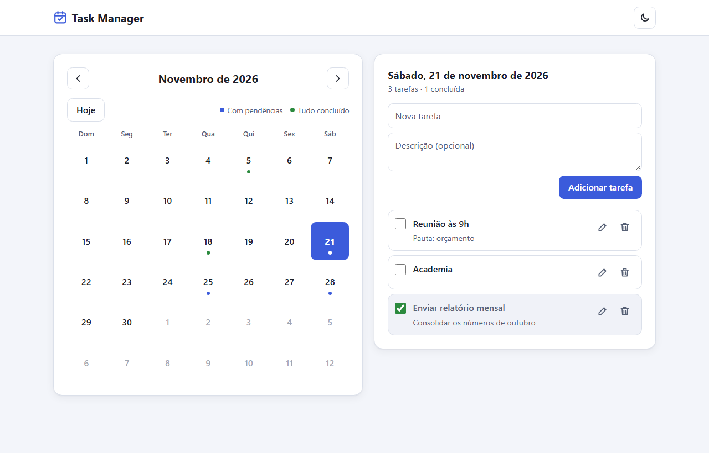
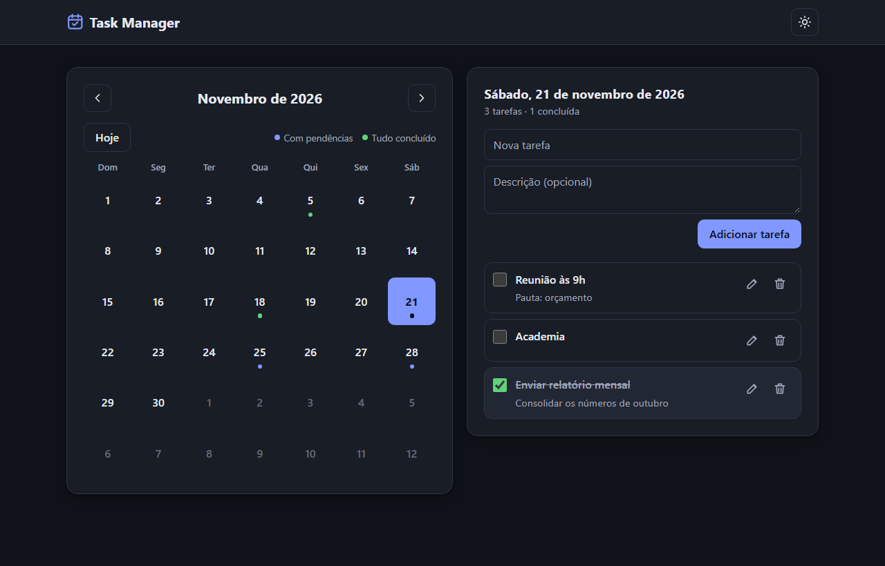
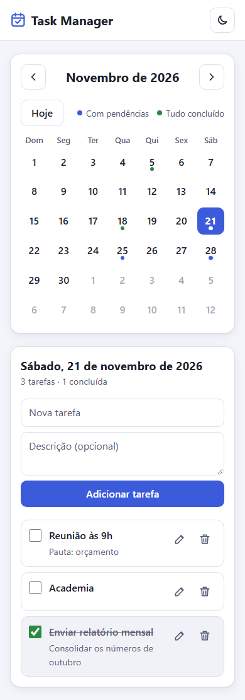

# Manual do Usuário

Veja como usar o task-manager: [como_usar_o_task-manager.mp4](videos/como_usar_o_task-manager.mp4)

O Task Manager ajuda você a organizar suas tarefas por dia. Este manual mostra como usar cada parte da tela.

Para instalar e iniciar a aplicação, consulte o [Manual de Instalação](INSTALACAO.md). Com ela em execução, abra <http://localhost:8080> no navegador.

## 1. Apresentação da interface

A tela tem três áreas:

1. **Cabeçalho:** o nome da aplicação, à esquerda, e o botão de tema (sol ou lua), à direita.
2. **Calendário:** o mês atual, com botões para navegar e uma legenda dos marcadores.
3. **Painel de tarefas:** a data selecionada por extenso, a contagem de tarefas, o formulário de cadastro e a lista de tarefas do dia.

Em telas largas, o calendário e o painel ficam lado a lado. No celular e em telas estreitas, o painel fica abaixo do calendário.

Ao abrir a aplicação, o dia de hoje já está selecionado e suas tarefas aparecem no painel.

## 2. Navegação pelo calendário

| Ação | Como fazer |
|---|---|
| Ver o mês anterior | Clique na seta **‹**, à esquerda do nome do mês. |
| Ver o mês seguinte | Clique na seta **›**, à direita do nome do mês. |
| Voltar para hoje | Clique em **Hoje**. |
| Ver as tarefas de um dia | Clique no dia. |
| Ir para um dia do mês vizinho | Clique em um dos dias em cinza, no início ou no fim da grade. |

O que cada destaque significa:

| Aparência | Significado |
|---|---|
| Número com contorno colorido | Dia de hoje. |
| Fundo colorido preenchido | Dia selecionado. |
| Ponto azul abaixo do número | O dia tem pelo menos uma tarefa pendente. |
| Ponto verde abaixo do número | O dia tem tarefas e todas estão concluídas. |
| Número em cinza | Dia de outro mês, exibido para completar a semana. |

**Pelo teclado:** pressione `Tab` até chegar ao calendário e use as setas para mudar de dia. `←` e `→` andam um dia; `↑` e `↓` andam uma semana. Ao passar do fim do mês, o calendário troca de mês sozinho.

## 3. Cadastro de tarefas

1. Selecione o dia no calendário.
2. No painel, digite o título no campo **Nova tarefa** (obrigatório, até 120 caracteres).
3. Se quiser, escreva detalhes no campo **Descrição (opcional)** (até 1000 caracteres).
4. Clique em **Adicionar tarefa** ou pressione `Enter` no campo do título.

A tarefa aparece na lista como pendente, o calendário passa a marcar o dia e a mensagem "Tarefa adicionada." aparece no canto da tela. O cursor volta ao campo do título, pronto para a próxima tarefa.

Se o título estiver vazio, o campo fica destacado em vermelho e aparece a mensagem "Informe o título da tarefa."

## 4. Edição e exclusão

Cada tarefa tem dois botões à direita.

### Editar

1. Clique no ícone de **lápis** da tarefa.
2. Na janela que se abre, altere o título e a descrição.
3. Clique em **Salvar**. Para desistir, clique em **Cancelar** ou pressione `Esc`.

A data da tarefa não muda na edição. Para mudar uma tarefa de dia, cadastre-a no novo dia e exclua a antiga.

### Excluir

1. Clique no ícone de **lixeira** da tarefa.
2. Confirme em **Excluir**, ou clique em **Cancelar** para manter a tarefa.

A exclusão é definitiva e não pode ser desfeita.

## 5. Marcação de tarefas concluídas

Marque o **checkbox** à esquerda da tarefa. Também é possível clicar no título da tarefa.

Uma tarefa concluída:

- fica com o título riscado e em cor mais clara;
- ganha um fundo diferente;
- vai para o fim da lista, depois das pendentes.

Para voltar a tarefa a pendente, desmarque o checkbox.

A situação é gravada na hora. Ela continua a mesma se você recarregar a página ou reiniciar a aplicação. A contagem no topo do painel (por exemplo, "3 tarefas · 1 concluída") e o ponto do dia no calendário são atualizados automaticamente.

## 6. Alternância entre modo claro e escuro

Clique no botão do canto superior direito do cabeçalho:

- o ícone de **lua** ativa o modo escuro;
- o ícone de **sol** ativa o modo claro.

A escolha fica salva no navegador e é mantida nos próximos acessos. No primeiro acesso, a aplicação segue o tema configurado no sistema operacional.

A preferência é salva por navegador: se você usar outro navegador ou uma janela anônima, o tema pode ser diferente.

## 7. Mensagens

Mensagens curtas aparecem no canto inferior da tela e somem sozinhas após alguns segundos.

| Mensagem | Significado |
|---|---|
| Tarefa adicionada. / atualizada. / excluída. | A operação foi concluída. |
| Tarefa concluída. / marcada como pendente. | A situação da tarefa foi gravada. |
| Informe o título da tarefa. | O título está vazio. |
| Não foi possível conectar ao servidor... | A aplicação não está em execução. Inicie-a e recarregue a página. |
| Tarefa *N* não encontrada. | A tarefa já tinha sido excluída, por exemplo em outra aba. Recarregue a página. |

## 8. Exemplos de utilização

### Planejar a semana

1. Clique no dia da próxima segunda-feira e cadastre "Reunião de equipe" com a descrição "Sala 3, às 10h".
2. Clique na quarta-feira e cadastre "Entregar relatório".
3. Clique na sexta-feira e cadastre "Academia".

Os três dias passam a mostrar um ponto azul, e você vê a semana planejada de relance.

### Acompanhar o dia

1. Abra a aplicação. O dia de hoje já aparece selecionado.
2. Conforme terminar cada tarefa, marque o checkbox.
3. Quando todas estiverem concluídas, o ponto do dia fica verde.

### Revisar o mês anterior

1. Clique na seta **‹** para voltar um mês.
2. Os pontos azuis mostram os dias que ficaram com pendências. Clique em cada um para revisar.
3. Para uma pendência que ainda vale, cadastre-a em uma data nova e exclua a antiga.

### Usar no celular

Com a aplicação acessível pela rede (veja `TASKMANAGER_ADDRESS` no [Manual de Instalação](INSTALACAO.md)), abra o endereço no navegador do celular. O calendário aparece em cima e as tarefas logo abaixo.

